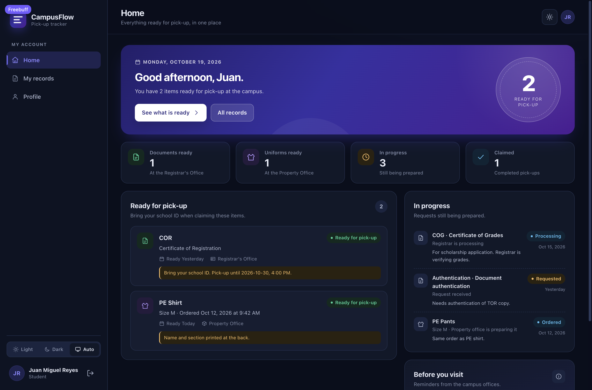
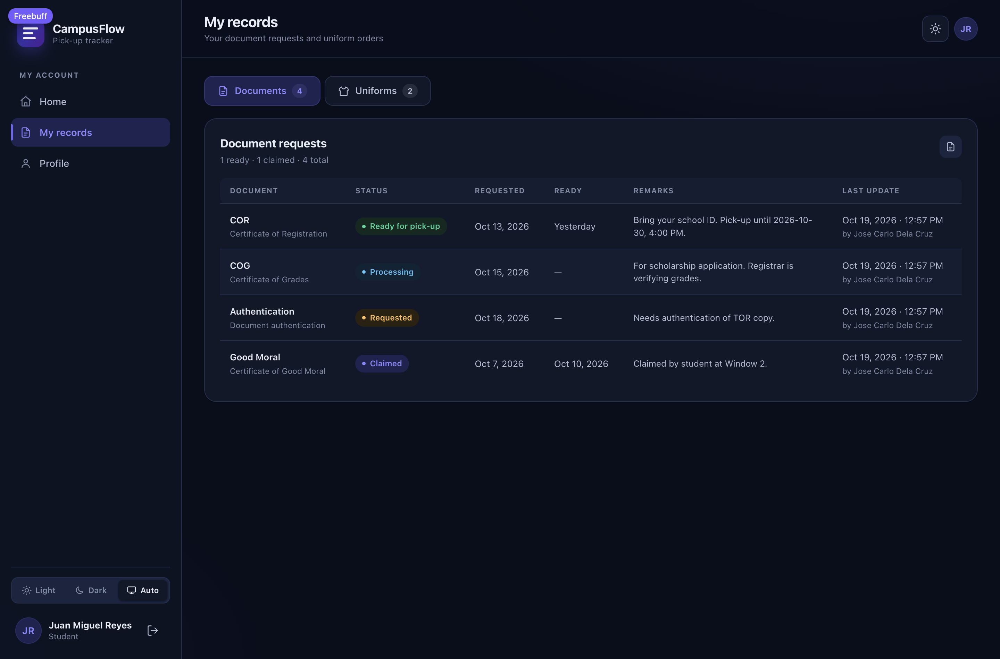
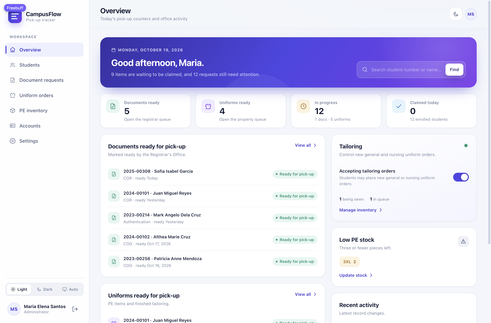

# CampusFlow

A campus pick-up tracker for **student documents** and **uniforms**. Students see exactly what is ready before travelling to school; registrar and property staff encode records and update statuses from one dashboard.

Built with React + TypeScript (Vite) on the front end, Express on the back end, and SQLite (Node's built-in `node:sqlite`) for storage. No external services, no cloud account — everything stays on the machine running it.



## Quick start

```bash
./start.sh
```

That starts the API (`http://localhost:4318`) and the Vite dev server (`http://localhost:4317`). Open **http://localhost:4317**.

The launcher uses the project-local Node runtime in `.tools/` when present, otherwise `node` from your PATH (Node **22.5+** is required for `node:sqlite`). The database is created and seeded automatically at `data/campusflow.db`.

Production-style run (builds the front end and serves everything from the API port):

```bash
./start.sh --prod     # then open http://localhost:4318
```

### Opening the folder from Finder

`index.html` is the app's entry point, but it is not a page that works when double-clicked: browsers refuse to run module scripts and reach `localhost` from a `file://` address, so Chrome shows an empty tab. Two ways in:

- **macOS** — double-click **`Start CampusFlow.command`**. It starts the server, waits until it answers, then opens http://localhost:4317 by itself. Keep the Terminal window open while you use the app; `Ctrl+C` (or closing the window) stops it.
- **Any platform** — run `./start.sh` in this folder and open http://localhost:4317.

Opening `index.html` from disk now shows a short launcher page that explains this and links to the running app, instead of a blank tab.

### Demo accounts

| Role | Username | Password |
| --- | --- | --- |
| Student | `2024-00101` | `Campus123` |
| Student | `2024-00102` | `Campus123` |
| Registrar staff | `registrar` | `registrar123` |
| Property custodian | `custodian` | `custodian123` |
| Administrator | `admin` | `admin123` |

The sign-in screen also has one-click demo account buttons. Student accounts exist for six seeded students; the rest of the roster is intentionally left without logins so you can try self-registration and bulk import.

## What each role can do

| Capability | Student | Registrar | Custodian | Admin |
| --- | :---: | :---: | :---: | :---: |
| Sign in / sign out | ✓ | ✓ | ✓ | ✓ |
| Home summary of ready items | own records | — | — | — |
| View/search student records | own only | ✓ | ✓ | ✓ |
| See the other desk's data (uniforms vs documents) | — | — | — | ✓ |
| Update document records | — | ✓ | — | ✓ |
| Update uniform records | — | — | ✓ | ✓ |
| Cancel a document request (keeps the record) | — | ✓ | — | ✓ |
| Cancel a uniform order (keeps the record) | — | ✓ | ✓ | ✓ |
| PE Pants / PE Shirt stock per size | counts on home | view only | ✓ | ✓ |
| Tailoring open/closed toggle | sees status | — | ✓ | ✓ |
| Add students / import roster / student logins | — | ✓ | — | ✓ |
| Correct a student number (moves records + login) | — | ✓ | — | ✓ |
| Delete a student (with their records and login) | — | ✓ | ✓ | ✓ |
| Staff accounts & settings | — | — | — | ✓ |

## The account question — decided

**Primary onboarding: staff import.** The registrar (or admin) adds students one at a time with **Students → Add student**, or imports the registrar's student list (CSV paste or file) with **Students → Import list**. Optionally tick *Create logins*: every new student without an account receives the **default student password** (`Campus123` by default). Students then change their password from **Profile**.

**Secondary onboarding: verified self-registration.** A student can create an account only if their student number already exists on the roster. The account inherits the official name and program from the roster, and the record link is always the student number. This can be switched off in **Settings → Student accounts**.

This avoids students inventing a student number while keeping the admin's workload low. Password resets are available per student from the student record or the Accounts page.

A student number is never locked once saved: **Edit info** on a student record lets the registrar replace it with the ID the registrar's office actually uses. The change moves the student's documents, uniform orders and student login (username plus link) to the new number in one transaction, so old and new never coexist.

CSV columns:

```csv
student_no,full_name,program,year_level,section,email
2026-00001,Maria Clara Lopez,BS Information Technology,1st Year,A,maria.lopez@campus.edu.ph
```

Rows without `student_no` or `full_name` are skipped and reported; existing students are updated rather than duplicated.

## Records and statuses

Every record is linked to `students.student_no` — never to a display name — and carries:

- `remarks` — free-text notes such as “Bring ID” or “Pick-up until Oct 30”
- `encoded_by` — who created the record
- `updated_by` — who last changed it
- `updated_at` / `created_at` — ISO timestamps

### Document records

Types: COR, COG, TOR, Authentication, Good Moral, Certificate of Enrollment, Certificate of Completion, Other.

The app tracks documents; it does not create requests. There is no “Add document” action and no create endpoint: staff correct an existing record, move it through its statuses, or cancel it.

Statuses: **Requested → Processing → Ready for pick-up → Claimed** (or Cancelled). Marking a document ready fills **Date ready** automatically. The student's home page highlights ready documents and shows remarks, office, and date.

Both desks show a **progress strip** on every record — Requested → Processing → Ready → Claimed for documents, Ordered → Ready → Claimed for uniforms — so the finished steps, the current stage, and what is still outstanding are visible at a glance in the staff tables, a student's record, and the student's own screens.

### Uniform orders

Uniforms are **tracked, not ordered from the app**. There is no order form and no create endpoint: staff can update, correct, or cancel an existing uniform order, but nothing new can be added.

- **P.E. uniform** — separate **Pants** and **Shirt** records, each with an item, size, order date, and order time. P.E. Pants come in **S–3XL** and P.E. Shirt in **XS–3XL**.
- **General / Nursing uniform** — no size; tracked through tailoring: **In queue → Being sewn → Sewing finished**.

Statuses: **Ordered → Ready for pick-up → Claimed** (or Cancelled).

### PE inventory

Stock is counted **per piece**: a **P.E. Pants** panel (S–3XL) and a separate **P.E. Shirt** panel (XS–3XL), each showing one card per size. ± buttons adjust stock quickly; “Set exact quantity” records a physical count. **Marking a P.E. order as Claimed deducts one piece from that piece and size**, and moving it back out of Claimed restores it — a P.E. Pants claim never touches Shirt stock. Low stock (≤ 3) is flagged on the dashboard and on the matching size card.

**Students see the counts on their home page.** A **P.E. stock** card on the student home lists the sizes that are currently on hand — P.E. Pants and P.E. Shirt — with the number of pieces and a running total per piece. Sizes with no stock are not listed, and sizes with three pieces or fewer turn amber. Chips for the student's own uniform sizes are outlined in violet. The card is a reference: there is nothing to order from it. It reads the same stock the custodian edits, so a claim or recount is reflected on the next load.

### Tailoring toggle

Custodian and admin can mark the tailoring desk open or closed with the **Accepting tailoring orders** switch on the dashboard, inventory page, or Settings. Students see the current availability on their home page as information, since the app does not take orders.

## Student experience

- **Home** — greeting, count of ready items, ready document/uniform cards with remarks and pick-up location, in-progress list, tailoring availability, office hours and pick-up reminder.
- **My records** — tabbed document and uniform tables including status, dates, tailoring, remarks, and who last updated each record.
- **P.E. stock card** — the P.E. Pants and P.E. Shirt sizes currently on hand, with pieces left, the student's own sizes outlined, and low stock in amber — reference only, no ordering.
- **Profile** — profile photo upload with a crop step (drag, zoom, rotate, then save; exported at 320×320), name and email, student enrollment details, password change, and light / dark / system theme.



## Staff experience

- **Overview** — ready counters, today's claims, quick student search, ready queues, tailoring toggle, low-stock alert, recent activity.
- **Students** — search by student number/name/program, ready and pending counts, account status; **Add student** and **Import list** (registrar and admin); tap any student to open their record.
- **Student record** — everything for one student: documents, uniform records, account controls, and add/edit dialogs.
- **Document records / Uniform orders** — filterable queues with a per-record progress strip, status chips, remarks, last-updater, and role-appropriate editing.
- **PE inventory** — one panel per piece (P.E. Pants S–3XL, P.E. Shirt XS–3XL) with a card per size, ± controls, low-stock highlighting, and the tailoring toggle.
- **Accounts** — staff logins (create/edit/reset/remove) and student logins (reset/remove). Removing a login never deletes records.
- **Settings** — school year, semester, office hours, pick-up reminder, default student password, self-registration toggle, tailoring availability.



## Data model

```
students (student_no PK, full_name, program, year_level, section, email, timestamps)
users (username, role, password_hash, avatar, student_no FK, timestamps)
sessions (token_hash, user_id, expires_at)

documents (student_no FK, doc_type, status, date_requested, date_ready,
           remarks, encoded_by, updated_by, timestamps)

uniform_orders (student_no FK, category, item, size, status, tailoring_status,
                date_ordered, time_ordered, remarks, inventory_deducted,
                encoded_by, updated_by, timestamps)

pe_inventory (item PK, size PK, quantity)  -- item is 'Pants' or 'Shirt'
settings (key, value)
activity_log (actor, action, entity, entity_id, detail, created_at)
```

Each desk only sees its own work: the registrar's overview, student records and activity feed show document requests, and the Property Office's show uniform orders and P.E. stock. Only the administrator sees both. This is enforced in the API (a registrar calling `/uniforms` gets 403, and student records return an empty uniform list for them), not just in the interface.

Passwords use `scrypt` with per-user salts. Sessions are stored as SHA-256 hashes of random 256-bit tokens and expire after 7 days. Sign-in attempts are throttled. Students can only read their own records; staff reads are limited to signed-in staff; mutations are role-gated on the server, not just hidden in the UI.

## Scripts

| Command | Purpose |
| --- | --- |
| `./start.sh` | Install if needed, then run API + Vite dev server |
| `Start CampusFlow.command` | macOS: double-click to start the server and open the app |
| `./start.sh --prod` | Build and serve the app from the API server |
| `npm run dev` | Same dev setup via npm (requires Node on PATH) |
| `npm run build` | Production front-end build into `dist/` |
| `npm start` | Serve `dist/` + API on port 4318 |
| `npm run typecheck` | TypeScript check |
| `npm run seed` | Delete and reload demo data (restart the app afterwards) |

### Ports

- `4317` — Vite dev server (proxies `/api` to 4318)
- `4318` — Express API and, when `dist/` exists, the built app

Override the API port with `PORT=…`; Vite's proxy target is configured in `vite.config.ts`.

## Project layout

```
server/            Express API, SQLite schema, seed data, auth
src/pages/         Student pages and staff workspace
src/components/    App shell, UI primitives, record dialogs
src/context/       Auth, theme and toast providers
src/lib/           API client, types, formatting, image helper
data/              Local SQLite database (ignored by git)
scripts/           Dev launcher and demo-data reset
```

## Notes for real deployment

This is designed as a self-contained capstone/demo system running on one machine. Before using it in production:

- Put it behind HTTPS and a reverse proxy, and change all demo passwords.
- Replace the local SQLite file with a managed database or a scheduled backup routine.
- Add institutional single sign-on if the campus already has it.
- Remove or gate the demo account shortcuts on the sign-in screen.
- Review data privacy rules for storing student records and profile photos (photos are currently stored as resized data URLs in SQLite).
